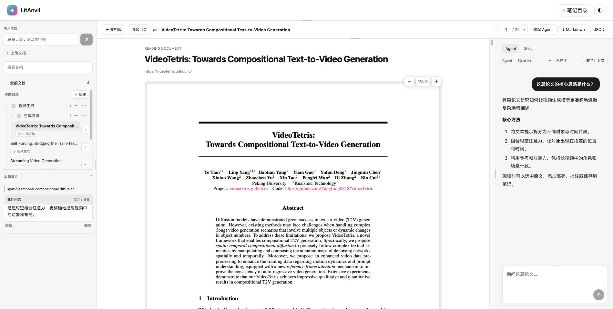

# LitAnvil

**An AI-native workspace for reading and organizing research.**

LitAnvil gives your research agent access to the same library, papers, annotations, and notes you use. Ask it to investigate a question, find related work in your library, organize papers into topics, navigate to evidence, and write up what you learned. The results become part of your workspace and remain editable in the reader.



*Reader view with demonstration content. The example paper is [VideoTetris](https://videotetris.github.io/).*

## Built for an agent to work alongside you

Reading tools and agent tools share the same underlying library. The agent can inspect and operate the reader through LitAnvil's MCP interface, while you can review and edit the results in the interface:

- **Navigate the paper:** open documents, go to a page, adjust the reader, and preview matching passages. A preview is temporary; it becomes an annotation only when saved.
- **Work with evidence:** read, create, edit, delete, and restore highlights and annotations. Notes accept Markdown and math, and PDF annotations can be anchored to the text.
- **Maintain the notebook:** read and update a paper's Markdown research note. Revision checks protect concurrent edits, and open readers synchronize changes.
- **Organize the library:** import a paper from a URL, rename or restore it, create nested topics, and assign multiple colored topic labels. Ask the agent to organize papers by research area or method; you can adjust the result yourself.
- **Retrieve across papers:** search the project knowledge index for relevant passages and find similar papers, then open the source document to examine the evidence.

For example, you can ask:

> Find papers in my library about consistency distillation, compare their approaches, highlight the relevant passages, and save a summary to this paper's notes.

> Organize these papers under video generation, with subtopics for real-time generation and distribution matching. Add the relevant labels to each paper.

> Open the paper, go to the experimental results, and show me where the authors compare the training costs.

The agent acts through explicit tools; it does not need to simulate mouse clicks to make these changes. The library, notes, and UI stay useful on their own, and destructive library operations are recoverable from the recycle bin.

## Research retrieval (RAG)

LitAnvil can use QMD as a project-scoped retrieval index over the configured notes directory's `papers/` collection. The index is updated as the library is synchronized. The agent can search by keyword or use semantic search when embeddings are available; similar-paper search falls back to keyword candidates when vector search returns no results. Results contain source information and snippets for the agent to follow up against the original document.

Install the `qmd` CLI separately and make it available on the service's `PATH`, or set `QMD_BIN` to its executable path. Retrieval requires QMD; reading, annotation, and chat remain available without it. Set `LITANVIL_QMD=off` to disable the integration. The index is scoped to the selected notes workspace, so separate projects have separate indexes.

## Your workspace

- **Paper reader:** import arXiv links and PDFs, or upload PDF, Markdown, and text files; read the document next to the conversation.
- **Library that grows with your research:** use nested topics, multiple colored tags, priorities, and drag-and-drop organization.
- **Connected notes and annotations:** keep highlights, comments, and a Markdown notebook with the paper. Configure a notes directory, including an Obsidian vault, for local Markdown exports.
- **Persistent agent sessions:** use your installed Codex or Claude Code CLI, with sessions separated by workspace and provider.
- **An adjustable reading layout:** resize the reader, conversation, and directory panels; switch between light and dark themes.

## Run

Install Node.js and the Codex / Claude Code CLIs you want to use, then complete their account login.

```sh
npm ci
npm run dev
```

The API listens on `127.0.0.1:8787`; Vite prints the frontend URL (default port 5173). The Agent selector uses the installed CLI backends. Both the homepage and reader sidebar use the same chat UI and server-owned sessions.

Choose a notes directory from the header. Agent sessions are separated by directory and provider. Switching providers resumes that provider's own conversation. Clearing context affects the selected provider only.

## Local CLI

Install the checkout as a local command (requires Node.js and the dependencies above):

```sh
npm run install-cli
lita start          # Build the web app, then run API and Web in the background
lita open           # Start if needed and show the app in your default browser
lita status
lita stop
```

`lita start --open`, `restart`, `web` (alias for `open`), `logs` and `--help` are also available. Commands work from any directory. Web uses `http://localhost:5173`, API uses port 8787. Occupied ports are reported without closing unrelated processes. A small local supervisor owns the child processes, waits for readiness and forwards graceful shutdown. Repeated starts reuse the running service. Runtime metadata lives under `data/cli/`; logs are in `logs/service.log`. `npm unlink -g lita` removes the command; this installation points at the current checkout.

The CLI resolves the Codex executable before starting the Agent. If the Codex installation is outside the service PATH, set `CODEX_BIN` to its absolute path and rerun `npm run install-cli`; on macOS, `command -v codex` shows the path.

## Reader

- Import an arXiv URL from chat, or upload PDF / Markdown / text from the library.
- Select PDF text and save a highlight or Markdown comment from the right composer. Comments support `$inline math$` and `$$display math$$`; the left panel opens the same right-side editor and provides deletion.
- Drag panel boundaries to resize sidebars and document/annotation sections. At narrow widths the PDF/chat boundary adjusts their heights. The header and reader toolbar also have draggable lower edges.
- Deleted documents and comments can be undone immediately or restored from the library recycle bin.
- Double-click a separator to restore its default size; focused separators support arrow keys and Home. Layout dimensions are saved in this browser.
- Agents use the local MCP interface to navigate pages, preview text, import/rename/restore documents and create/edit/delete/restore annotations. Temporary previews do not create annotations. All open tabs update automatically.

## Development

```sh
npm test
npm run build
```

Provider adapters and the common runtime are tested independently of live accounts. See [architecture](docs/architecture.md) for the v1 session contract, endpoints, storage and extension boundaries, and [acceptance](docs/acceptance.md) for verified behavior and remaining work.

Local `data/`, `uploads/`, `notes/`, logs and credentials are excluded from Git.


Codex and Claude load project configuration for the notes workspace. Codex keeps a private native home under ignored runtime data and reuses the existing file-based login; global user plugins, MCP servers and skills are not automatically inherited. Put project Codex settings in `.codex/config.toml` and skills in `.agents/skills/` within the project. Existing native thread history remains shared through its selected rollout file. System policy still applies.
