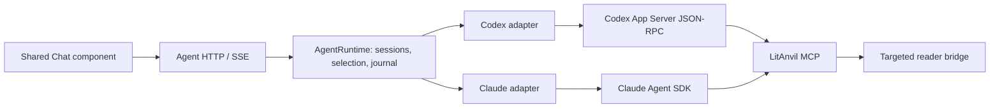

# LitAnvil agent runtime

LitAnvil uses a local runtime with provider adapters, inspired by Happy's separation of native agent harnesses, session protocol and presentation. This implementation owns its protocol; it does not depend on Happy's frozen `happy-wire` session schema.

## Boundaries

- `shared/agent.ts` is the versioned, provider-neutral frontend contract. Items are messages, public reasoning summaries, tools or notices. Frontend components never parse Codex notifications or Claude SDK events.
- `server/agent/provider.ts` defines connect/send/stop/clear/close. A new provider implements this adapter and registers its factory with the runtime.
- `server/agent/providers/codex.ts` translates the native App Server transport in `codex-native.ts`. Existing Codex resume/reconnect behavior and native thread IDs are retained. `server/session.ts` is a compatibility export for native integrations/tests.
- `server/agent/providers/claude.ts` runs the official Claude Agent SDK, streams partial text and tool input, reconciles final blocks by ID, resumes native sessions, interrupts in-progress turns, and polls idle native transcripts for outside updates. Thinking/signature blocks are excluded from the public projection.
- `server/agent/runtime.ts` owns workspace/provider selection, revisions, snapshots and change journals. Selection is shared by connected clients; switching while a turn is running is rejected. A failed provider can be switched away from. Clear creates a new native context only for the selected provider.
- `server/agent/http.ts` exposes the same routes for every provider. The document server supplies a context resolver; provider adapters know nothing about the PDF database or React.
- `server/ui-bridge.ts` and `src/useReaderBridge.ts` target one reader tab, authenticate acknowledgements by command/tab IDs, and wait for loaded PDF pages. Both providers use this MCP surface.

## HTTP contract

| Method | Path | Result |
| --- | --- | --- |
| GET | `/api/agent/providers` | Available CLI binaries and provider capabilities |
| GET | `/api/agent/state` | Current authoritative snapshot |
| GET | `/api/agent/events` | SSE snapshots with session/revision event IDs |
| GET | `/api/agent/history?after=N` | Provider journal records after revision N |
| POST | `/api/agent/provider` | `{provider: "codex" \| "claude"}` switches/resumes that backend |
| POST | `/api/agent/message` | `{text, documentId?, quote?}` starts a turn |
| POST | `/api/agent/stop` | Interrupts the selected provider |
| POST | `/api/agent/clear` | Starts a fresh selected-provider context |

`/api/session/*` remains an alias for callers; its event payload is the new v1 contract. This is a protocol change from native Codex items. New consumers should use `/api/agent/*`.

SSE reconnect sends the current full snapshot; clients do not have to reconstruct partial output from old network events. The revisioned change journal is separately available for diagnostics and replay consumers.

## Persistence and account settings

`data/agents/<workspace-hash>/selection.json` stores the selected backend. Each provider directory contains its native session metadata, `snapshot.json` and `events.ndjson`. Workspace and backend histories stay separate. Switching providers resumes that provider's own context; it does not transfer prompts or import the other provider's conversation. The default notes workspace migrates the original `data/session.json` Codex thread without removing the legacy file.

The notes directory remains the agent working directory. Claude loads project settings only and explicitly receives the LitAnvil MCP server. `claude-auth.ts` reuses only allowlisted authentication environment values and the account model default (project model wins); credentials stay in process memory and are not written to the runtime journal or project config. Native CLI OAuth/keychain login remains available. Codex global configuration inheritance is an existing limitation tracked in acceptance.md.

The reader library routes live in `server/library.ts`: `data/db.json` stores documents and annotations, original files live in `uploads/`, and notes are exported atomically. A `deletedAt` marker preserves deleted records and original files for undo/recycle-bin recovery. Active library, context and MCP queries filter these records. URL aliases and original-file hashes back the import cache. PDF assets are resolved against the API origin. Annotation Markdown stays source text in JSON and is rendered through the same Markdown/KaTeX component as agent answers.

## Validation and current scope

Tests cover native Codex lifecycle/reconnect, canonical projections, streamed Claude text/tool reconciliation, SDK stop/resume, project/provider isolation, selection recovery, event history, failed-provider switching, credentials allowlisting, rendering, PDF sizing and document APIs. Native providers are injected in tests so middleware checks run without account access or model calls. Browser checks exercise real native agents separately.

This is a localhost runtime and reader client. Cross-device relay, encrypted remote synchronization, arbitrary native-terminal takeover and a multi-session browsing UI are outside the current implementation. Claude idle transcript polling observes completed native changes; concurrently running the same native session from another tool is not a supported takeover mechanism.

References: [Happy](https://github.com/slopus/happy), [Happy session protocol](https://github.com/slopus/happy/blob/main/packages/happy-wire/src/sessionProtocol.ts), [Claude Agent SDK](https://code.claude.com/docs/en/agent-sdk/typescript).
